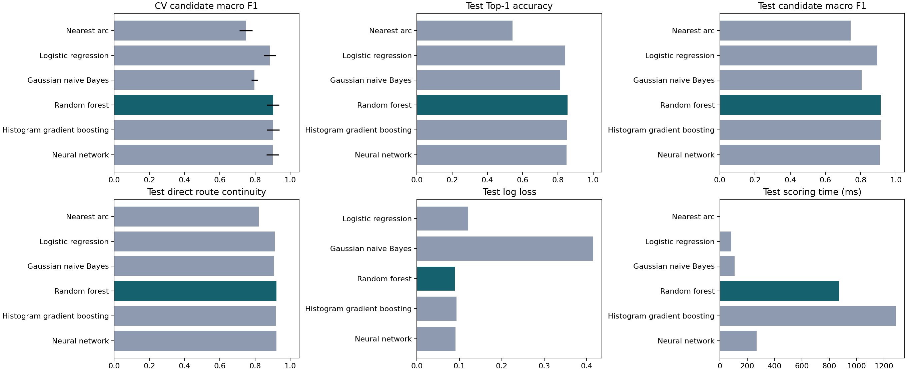
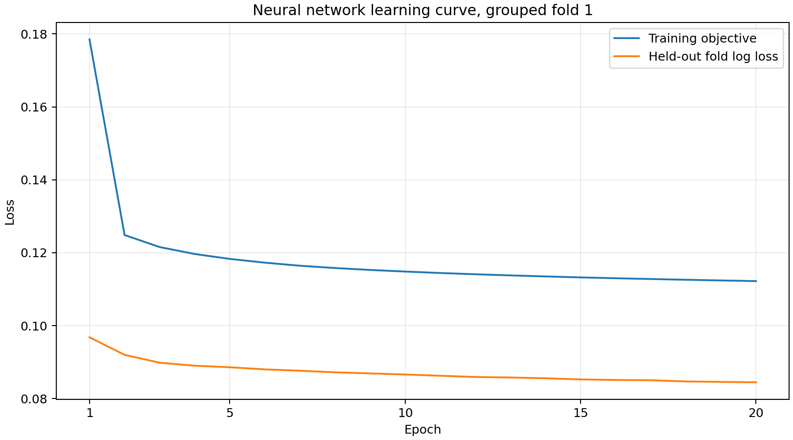

# 3. Model experimentation and comparison

## 3.1 Evaluation and overall comparison

Each row represents one nearby directed arc for one GPS observation. Features were point-to-arc distance, directed heading difference, GPS speed, arc length, fractional projected offset, candidate distance rank, candidate count, and distance above the nearest arc. Candidate generation kept up to 16 arcs within 50 m. Motion features used adjacent GPS steps up to five seconds apart. A candidate was positive if its arc matched the monotonic alignment to the reference route.

The comparison used all 80 training trips, five GroupKFold splits by trip, and 10 independent student-test trips (19,160 observations). Preprocessing was fitted within each training fold. The selection metric was mean validation Top-1 accuracy, with candidate macro F1 as the tiebreaker. Top-1 measures the primary prediction task, which is picking one correct arc for each GPS point.

Candidate macro F1 averages F1 for the negative and positive classes. Precision and recall refer to the positive class at a probability threshold of 0.5. Top-1 retains all reference observations in its denominator. Direct route continuity is the share of consecutive scored observations at most five seconds apart whose predicted arcs stay the same or share a directed end-to-start node. The continuity metric measures immediate connectivity. Fit time is for the final training run, and score time is the median of three full test-batch inference passes including preprocessing.

| Model | Family | Key configuration | CV macro F1 (mean +/- SD) | Test Top-1 | Test macro F1 | Test continuity | Test log loss | Score (ms) |
| --- | --- | --- | ---: | ---: | ---: | ---: | ---: | ---: |
| Nearest arc | Geometry baseline | Smallest point-to-arc distance | 0.7489 +/- 0.0366 | 54.26% | 0.7424 | 82.15% | N/A (hard choice) | 0.84 |
| Logistic regression | Linear classifier | L2, C=1, max_iter=300, scaled inputs | 0.8832 +/- 0.0338 | 84.24% | 0.8937 | 91.27% | 0.1205 | 84.18 |
| Gaussian naive Bayes | Generative probabilistic | Variance smoothing=1e-9, scaled inputs | 0.7973 +/- 0.0181 | 81.40% | 0.8049 | 90.78% | 0.4155 | 107.66 |
| Random forest | Bagged tree ensemble | 64 trees, depth 14, leaf min 20, bootstrap fraction 15%, seed 115 | 0.9019 +/- 0.0355 | 85.46% | 0.9133 | 92.18% | 0.0891 | 871.41 |
| Histogram gradient boosting | Boosted tree ensemble | 100 iterations, 31 leaves, rate 0.1, seed 115 | 0.9032 +/- 0.0355 | 85.20% | 0.9131 | 91.82% | 0.0936 | 1287.21 |
| Neural network | Multilayer perceptron | 32/16 hidden units, ReLU, Adam, batch 2048, 20 epochs maximum, seed 115 | 0.9000 +/- 0.0343 | 85.02% | 0.9102 | 92.10% | 0.0906 | 268.38 |

The selected model was **Random forest** (mean CV Top-1 76.95%). Its test Top-1 was **85.46%**, compared with **54.26%** for nearest arc. The model improved on nearest arc on 10 of the 10 test trips. The test candidate miss rate was 0.17%.

Random Forest and histogram gradient boosting were close on mean CV Top-1. Boosting had slightly higher CV macro F1. Random Forest led on the primary selection metric and gave the lowest test log loss. The near tie on cross-validation does not establish that either classifier will consistently outperform the other.

## 3.2 Per-model evidence

Fitted-training macro F1 is a resubstitution score. Its difference from grouped validation macro F1 shows the size of the generalization gap on this split. The gap alone cannot identify whether model capacity, optimization, or differences among trips caused it.

### Nearest arc

- **Rationale and limitations.** Measures how much geometry alone can recover. Opposite directions and parallel roads can be close to the same point.
- **Configuration and objective.** Smallest point-to-arc distance. Selects the minimum distance.
- **Student-test results.** Top-1 54.26%, macro F1 0.7424, precision 0.5426, recall 0.5436, log loss unavailable for the hard choice, fit time 0.00 s, score time 0.84 ms.
- **Training vs. validation.** Macro F1 was 0.7443 on fitted training trips and 0.7489 in grouped CV. The difference was -0.45 percentage points.

### Logistic regression

- **Rationale and limitations.** Provides an efficient probability model. Its linear log-odds cannot express feature interactions without feature transformations.
- **Configuration and objective.** L2, C=1, max_iter=300, scaled inputs. Minimizes penalized logistic loss.
- **Student-test results.** Top-1 84.24%, macro F1 0.8937, precision 0.8228, recall 0.7997, log loss 0.1205, fit time 11.11 s, score time 84.18 ms.
- **Training vs. validation.** Macro F1 was 0.8810 on fitted training trips and 0.8832 in grouped CV. The difference was -0.22 percentage points.

### Gaussian naive Bayes

- **Rationale and limitations.** Fits quickly and scores candidates using class-conditional likelihoods. Closely related distance features challenge the conditional independence assumption.
- **Configuration and objective.** Variance smoothing=1e-9, scaled inputs. Fits per-class Gaussian feature statistics and applies Bayes' rule.
- **Student-test results.** Top-1 81.40%, macro F1 0.8049, precision 0.5318, recall 0.9022, log loss 0.4155, fit time 6.47 s, score time 107.66 ms.
- **Training vs. validation.** Macro F1 was 0.7958 on fitted training trips and 0.7973 in grouped CV. The difference was -0.15 percentage points.

### Random forest

- **Rationale and limitations.** Can learn interactions among heading, speed and geometry. Scoring requires traversing every tree.
- **Configuration and objective.** 64 trees, depth 14, leaf min 20, bootstrap fraction 15%, seed 115. Splits trees to reduce Gini impurity and averages the tree probabilities.
- **Student-test results.** Top-1 85.46%, macro F1 0.9133, precision 0.8770, recall 0.8163, log loss 0.0891, fit time 54.63 s, score time 871.41 ms.
- **Training vs. validation.** Macro F1 was 0.9073 on fitted training trips and 0.9019 in grouped CV. The difference was +0.54 percentage points.

### Histogram gradient boosting

- **Rationale and limitations.** Learns nonlinear interactions with histogram-based splits. Prediction cost depends on the number and shape of the trees.
- **Configuration and objective.** 100 iterations, 31 leaves, rate 0.1, seed 115. Adds trees to reduce binary log loss.
- **Student-test results.** Top-1 85.20%, macro F1 0.9131, precision 0.8530, recall 0.8386, log loss 0.0936, fit time 25.65 s, score time 1287.21 ms.
- **Training vs. validation.** Macro F1 was 0.9107 on fitted training trips and 0.9032 in grouped CV. The difference was +0.76 percentage points.

### Neural network

- **Rationale and limitations.** Learns nonlinear combinations of scaled features. Training is sensitive to convergence and the iteration budget.
- **Configuration and objective.** 32/16 hidden units, ReLU, Adam, batch 2048, 20 epochs maximum, seed 115. Minimizes binary log loss with L2 regularization.
- **Student-test results.** Top-1 85.02%, macro F1 0.9102, precision 0.8751, recall 0.8074, log loss 0.0906, fit time 149.23 s, score time 268.38 ms.
- **Training vs. validation.** Macro F1 was 0.9016 on fitted training trips and 0.9000 in grouped CV. The difference was +0.16 percentage points.

## 3.3 Visualizations and reproducibility





A separate 20-epoch neural network run monitored the first grouped validation fold. Validation log loss fell from 0.0968 to 0.0845. The learning curve uses a held-out training fold only.

The comparison includes CV macro F1 with fold standard deviation, student-test Top-1 accuracy, student-test macro F1, direct route continuity, log loss, and score time. The confusion counts and measured fit times are in the comparison CSV. The train/test trip IDs, seed, model settings, and exact grouped validation assignments are recorded with the results.

Run from the repository root with the student dataset extracted:

```powershell
python -m pip install -r requirements.txt
python -m unittest discover -s tests -p test_person_b.py
python -m src.train_models . --jobs 4 --output results/person_b_final
python -m src.neural_network_curve .
```

AI assistance was used for implementation and drafting. The reported metrics come from executing the experiments on the provided student dataset.

The run saves the fitted pipeline as `best_model.joblib`. The decoder handoff is `test_candidate_probabilities.parquet` with trip ID, observation index, arc ID, and positive-class probability. Call `src.train_models.predict_trip(bundle, trip)` for a new loaded trip.
