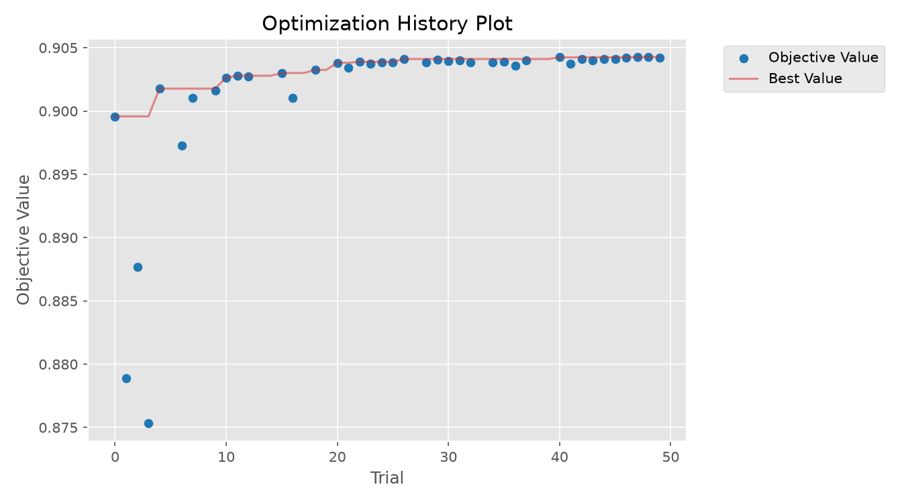
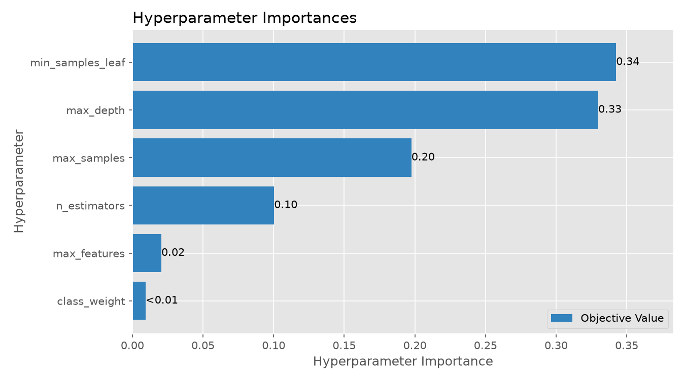

# 4. Bayesian hyperparameter optimisation

## 4.1 What was tuned and why

Section 3 selected the **Random forest** (best mean grouped-CV Top-1). Its hyperparameters were hand-picked, so we tuned them with Bayesian optimisation in Optuna (`tuning/hpo.py`).

| Setting | Value |
| --- | --- |
| Model | Person B's pipeline: median imputer + `RandomForestClassifier` (seed 115, `n_jobs=-1`) on the 8 candidate features |
| Objective (maximised) | Mean candidate **macro F1** over 5-fold `GroupKFold` grouped by trip, on all 80 train trips. These are the same folds as Section 3, so the numbers are directly comparable. |
| Also logged per trial | Mean CV Top-1 accuracy, mean CV log loss, CV macro-F1 standard deviation, fit time (`trial.set_user_attr`) |
| Sampler | `TPESampler(seed=42)` (Tree-structured Parzen Estimator) |
| Pruner | `MedianPruner(n_startup_trials=5, n_warmup_steps=1)`. After each fold the running mean macro F1 is reported. A trial is stopped early if it is below the median of earlier trials at the same fold. |
| Storage | `sqlite:///tuning/study.db` (the study can be resumed) |
| Trials | 50 (40 completed, 10 pruned). Trial 0 was Person B's untuned configuration, so the baseline is part of the study. |
| `student_test` | Not used during the search. Used only once afterwards, for the tuned vs untuned comparison. |

**Speed-up.** The first full-data run took 20 to 176 s per trial, which was too slow for 50 trials. As the brief allows, each fold's model was **fitted on a random 25% of the GPS points of every training trip**, keeping all candidates of each sampled point. It was still **scored on the full validation fold**. This made trials about 4 times faster (untuned trial: 18 s down to 4 s) and lowered the untuned score only slightly (macro F1 0.9019 on full data, 0.8996 on the subsample). The final tuned model was refitted on all the data, and every number in Section 4.3 uses the full data.

## 4.2 Search space and best values

| Hyperparameter | Range searched | Untuned (Section 3) | Best (trial 48) |
| --- | --- | ---: | ---: |
| `n_estimators` | 50 to 200, step 10 | 64 | 110 |
| `max_depth` | 6 to 32 | 14 | 12 |
| `min_samples_leaf` | 1 to 200 (log scale) | 20 | 1 |
| `max_features` | sqrt, log2, 0.5, 0.75, 1.0 (8 features: 2, 3, 4, 6, 8 per split) | sqrt (2) | 1.0 (all 8) |
| `max_samples` (bootstrap fraction) | 0.05 to 0.40 | 0.15 | 0.25 |
| `class_weight` | None, balanced, balanced_subsample | None | None |

`class_weight` was searched because positives are rare (about one correct arc per candidate set of up to 16 arcs). Re-weighting did not help macro F1. The 4 completed class-weighted trials scored at most 0.9016, against 0.9043 for the best unweighted trial, and its importance was below 0.01.

The best value rose quickly over the first 20 trials and then levelled off. Completed trials had a median macro F1 of 0.9038 and a maximum of 0.9043 (subsampled objective), so more trials were unlikely to help.

The leaf size (`min_samples_leaf`, importance 0.34) and the tree depth (`max_depth`, 0.33) mattered most, followed by the bootstrap fraction (0.20). The best trees use all 8 features at every split and small leaves, but limited depth. The depth limit stops them from overfitting.

## 4.3 Tuned vs untuned

Both models were measured in the same run (`tuning/evaluate_tuned.py`). Each got full-data 5-fold grouped CV, was then refitted on all 80 train trips, and was scored on the 10 `student_test` trips (19,160 points). Scoring time is the median of 3 passes over all test candidates.

| Model | CV macro F1 (mean +/- SD) | CV Top-1 | CV log loss | Test Top-1 | Test macro F1 | Test log loss | Fit time (s) | Scoring time (ms) |
| --- | ---: | ---: | ---: | ---: | ---: | ---: | ---: | ---: |
| Untuned (Section 3) | 0.9019 +/- 0.0355 | 76.95% | 0.1069 | 85.46% | 0.9133 | 0.0891 | 11.9 | 218 |
| **Tuned (Optuna)** | **0.9046** +/- 0.0356 | **77.09%** | **0.1046** | **85.57%** | **0.9150** | **0.0861** | 19.2 | **99** |

**Did tuning help?** Yes, but only a little. The tuned forest is better on every quality measure: CV and test macro F1, Top-1 and log loss. In our timing it also scored the test set faster (99 ms vs 218 ms), although it takes longer to fit. However, the CV gain (+0.0027 macro F1) is much smaller than the fold-to-fold standard deviation (0.036). We therefore read it as a small, consistent improvement, not a clear win. Person B's hand-picked settings were already close to the best this model can do on these 8 features. The tuned model is the one deployed (`models/rf_tuned.joblib`, parameters in `models/best_params.json`).

Section 5.6 shows that the classifier's tuning mattered much less than adding the HMM. On `student_test`, classifier + Viterbi reaches 93.0 to 93.4% Top-1 with either forest.

**Reproduce:** `python tuning/hpo.py run DATA --trials 50`, then `python tuning/hpo.py report`, then `python tuning/evaluate_tuned.py DATA`. Outputs: `outputs/tuning/hpo_trials.csv`, `optimization_history.png`, `param_importances.png`, `tuned_vs_untuned.csv`, `hpo_run.log`.
