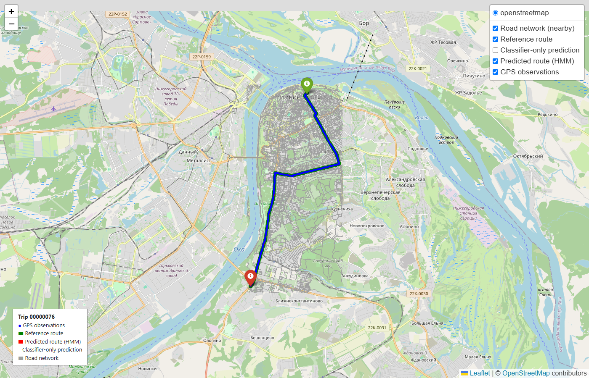
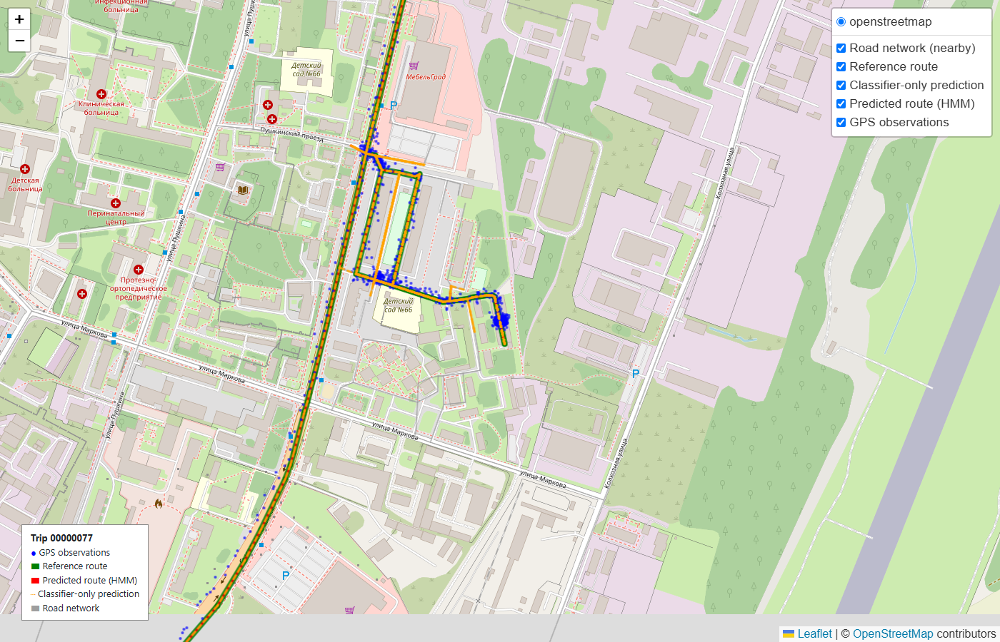

# 6. Geographical visualisation using Folium

All maps were generated from our actual pipeline with Folium on OpenStreetMap tiles. They are committed as interactive HTML files together with the code that makes them.

| Map | What it shows | Code | Committed HTML |
| --- | --- | --- | --- |
| EDA maps (Section 2.2), train trips 33, 48, 54 | GPS points, nearby roads, reference route | `src/eda.py` (`folium_map`) | `outputs/eda/map_*.html` |
| **Predicted-route maps**, student_test trips 07, 76, 77 | GPS points, nearby roads, reference route, classifier-only route, HMM route | `hmm/export_predictions.py`, then `src/final_map.py` | `outputs/maps/final_*.html` |

## 6.1 How the predicted-route maps are made

1. `hmm/export_predictions.py` runs each trip through the same pipeline the API serves (`api/pipeline.py`: tuned Random forest + HMM settings in `hmm/hmm_config.json`). It reads only `.track`, `.nodes` and `.arcs`. It writes one row per GPS point to `outputs/maps/predictions_student_test.csv`: the HMM arc (`pred_arc_id`) and the classifier-only arc (`clf_arc_id`). Unmatched points are written as blank, so they are skipped instead of being drawn as a wrong arc. The exported predictions give exactly the same per-trip Top-1 as the API (checked for all four exported trips).
2. `src/final_map.py` draws one map per trip from that CSV and the trip's files. The `.route` file is used only to draw the reference layer.

Only **student_test** trips are mapped. Evaluator trips were never used.

## 6.2 How the maps meet the requirements

| Requirement | How it is met |
| --- | --- |
| Original GPS observations | Blue dots, one per GPS point (thinned only for trips with 6,000 or more points), with the timestamp as a tooltip |
| Relevant road-network geometry | Thin grey lines: every road arc within 0.003 degrees of the trip's GPS bounding box |
| Reference route | Wide green line, drawn underneath |
| Predicted route | Red line (classifier + HMM) on top of the reference. Orange dashed line for classifier-only, off by default. |
| Distinguishable colours and markers | Blue / grey / green / red / orange. A green start marker and a red end marker. |
| Labels or legend | A fixed legend in the bottom-left corner, with the trip id |
| Extent and zoom | The map opens fitted to the GPS bounding box. It can be zoomed in to street level. |
| Easy GPS vs prediction comparison | Every layer can be switched on or off. Hiding the GPS dots shows red against green directly. Showing the orange layer compares classifier-only with HMM. |
| Layer controls | A Folium `LayerControl` with all five layers |

## 6.3 Representative maps

**Trip 00000076** (student_test) as the HTML opens: the whole trip, the road network around it, the legend and the layer control. The predicted route follows the reference from start to end. At this zoom the GPS dots cover the lines.

**Trip 00000077** (student_test), zoomed in to the long stop at points 2312 to 2587, with the classifier-only layer switched on. This is the same committed map: only the view was changed (zoom and one layer ticked). The blue cluster on the right is the stopped car. Its GPS jumps around inside a 31 x 61 m box. Picking the most probable arc at each point on its own (orange) jumps into side streets and short stubs around the stop. The HMM route (red) stays on the reference (green), because those jumps are not drivable between consecutive points.

## 6.4 What the maps show

The number of route segments drawn makes the difference visible. Every change of arc between consecutive points draws a new segment.

| student_test trip | Reference arcs | HMM segments | Classifier-only segments | Top-1 HMM / classifier | Route F1 HMM / classifier |
| --- | ---: | ---: | ---: | ---: | ---: |
| 00000007 | 123 | 123 | 234 | 99.34% / 91.95% | 98.37% / 96.41% |
| 00000076 | 374 | 368 | 514 | 96.30% / 85.80% | 89.56% / 76.53% |
| 00000077 | 268 | 461 | 1,579 | 83.99% / 69.24% | 93.94% / 76.97% |

(Top-1 and route F1 are from `results/api/student_test_pipeline_results.csv`. Segment counts are from the committed HTML maps.)

- **Trip 07** (best trip). The HMM route has as many segments as the reference (123) and a route F1 of 98.4%. The classifier-only route has 234, so it switches arcs back and forth 111 more times.
- **Trip 76.** The HMM adds 10.5 points of Top-1 and 13.0 points of route F1. Its route has 368 segments against 374 in the reference. The classifier-only route has 514.
- **Trip 77** (weakest trip, see Section 5.6). The car is stopped for about a third of the trip. Classifier-only draws 1,579 segments, almost six times the reference. The HMM cuts this to 461, the largest gain of the three trips (+14.8 points Top-1, +17.0 points route F1). It is still above the reference's 268, which fits the stop jitter described in Section 5.6.

**Reproduce:** `python hmm/export_predictions.py "<Student folder>\student_test" 00000007 00000052 00000076 00000077`, then `python src/final_map.py "<Student folder>" <trip> outputs/maps/predictions_student_test.csv outputs/maps/final_<trip>.html` for each mapped trip.
