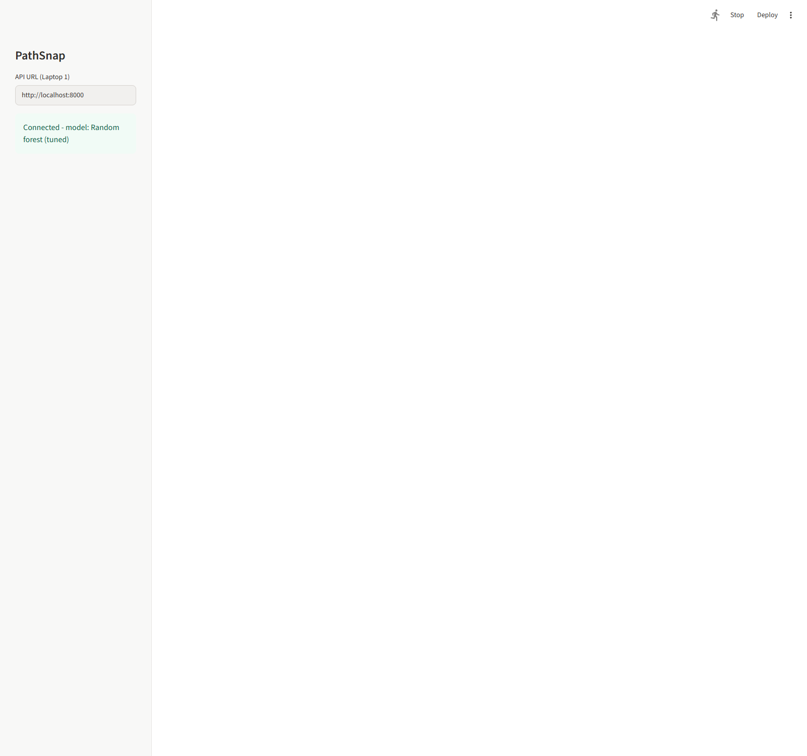
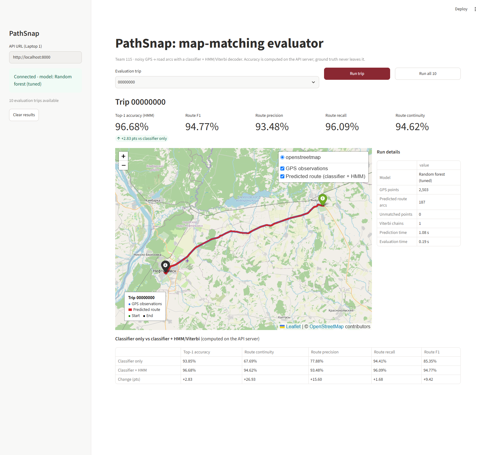

# 7. API, UI and Deployment

## 7.1 Two-laptop architecture

| Laptop | Component | Code | Responsibilities |
| --- | --- | --- | --- |
| Laptop 1 | FastAPI backend | `api/main.py`, `api/pipeline.py` | Loads the trained classifier and HMM config once at start-up. Holds the trip files, including the reference routes. Runs the full pipeline for the trip ID it receives, computes accuracy on the server and logs every request to its console |
| Laptop 2 | Streamlit UI | `ui/app.py` | Lists the trips the API offers, sends the selected trip ID to the API, and shows the predicted route on a Folium map with the scores the API returned |

```
Laptop 2 (UI)                                Laptop 1 (API)
streamlit ui/app.py   -- GET  /trips ----->  list trip folders in PATHSNAP_TRIPS_DIR
                      -- POST /predict --->  .track/.nodes/.arcs -> candidates (50 m, k<=16)
                         {"trip_id": ...}      -> 8 features per candidate -> tuned RF  
                                               -> log-probabilities as HMM emissions
                                               -> Viterbi (road-graph transitions) -> route
                                             .route (server only) -> Top-1, route P/R/F1,
                      <-- JSON ------------     continuity; logged to the console
draw GPS + predicted route, show scores
```

Both laptops join the same Wi-Fi. The API listens on `0.0.0.0:8000`, and the UI is given
`http://<Laptop-1-IP>:8000`.

## 7.2 Inference pipeline behind the API

`api/pipeline.py → Pipeline.predict(folder)` chains the team's components without changing them:

1. `hmm/decode.load_trip_no_labels` reads **only** `.track`, `.nodes` and `.arcs`. The `.route`
   file is never opened during prediction.
2. `src/candidates.generate_candidates` finds the arcs within 50 m of each GPS point and keeps
   the nearest 16 (Section 2).
3. `src/candidate_features.build_features` computes the 8 features. Before scoring, the pipeline
   checks that the feature rows are in exactly the same order as the candidate rows, because the
   decoder pairs probabilities with candidates by position.
4. The **Optuna-tuned Random forest** (`models/rf_tuned.joblib`, Section 4), named by `model_path` in
   `hmm/hmm_config.json`, gives `P(candidate is the true arc)`. Random forest was the model
   selected in Section 3. These probabilities become the HMM emissions
   (`log(p + 1e-9)`).
5. `hmm/decode.decode_trip` runs Viterbi with transitions from road-network shortest-path
   distances and the decoder settings tuned on train (`hmm/hmm_config.json`), then builds the
   driven route (Section 5).
6. The classifier-only prediction (the highest-probability candidate per point, no HMM) is
   computed from the same probabilities, so the API can report both side by side.

At start-up the API checks that the candidate radius and `max_k` in the model bundle match
`hmm_config.json`.

## 7.3 Endpoints

| Method and path | Request | Response |
| --- | --- | --- |
| `GET /health` | none | `status`, model name, trips folder, number of trips |
| `GET /trips` | none | `{"trips": ["00000000", ...], "count": 10}` |
| `POST /predict` | `{"trip_id": "00000077"}` | `point_arcs` (predicted arc per GPS point, -1 = none), `route` (driven arc IDs), `route_lonlat` (route geometry), `gps` (input points), `scores` (see below), `decoder_stats`, `timing_s` |

`scores` holds `hmm` and `classifier_only` blocks. Each block has `top1_accuracy`,
`route_continuity`, `route_precision`, `route_recall`, `route_f1` and `unmatched_points`.
`scores` is `null` if the server has no `.route` file for the trip.

**Ground truth stays on Laptop 1.** The model never sees `.route`. The response carries only the
metrics computed from it. The reference route and the per-point labels are never sent to the UI,
and `tests/test_api.py` checks this. Trip IDs are validated against the folder listing, so a
request such as `"../train"` is rejected with a 404.

**Console logging.** Every request is logged on Laptop 1: method, path, client IP, status and
time. Each `/predict` also logs the pipeline stages, the number of points and route arcs, and the
server-side Top-1, route F1, precision, recall and continuity. Example from
`results/api/api_console_log_student_test.txt`:

```
16:30:10 | INFO | === Trip 00000077: running pipeline (candidates -> features -> Random forest (tuned) -> Viterbi)
16:30:11 | INFO | Trip 00000077: 3911 GPS points -> 309 route arcs, 0 unmatched, 1.23 s
16:30:11 | INFO | Trip 00000077: Top-1 accuracy  HMM 83.99% | classifier-only 69.24%
16:30:11 | INFO | Trip 00000077: route F1 93.94% | precision 92.42% | recall 95.52% | continuity 93.51%
16:30:11 | INFO | POST /predict from 127.0.0.1 -> 200 (1559 ms)
```
A request for an unknown or path-like ID is logged as `WARNING | Unknown trip id '../train'`
and answered with a 404.

## 7.4 User interface

The UI asks the API for the trip list, so it automatically shows whichever ten trips are in the
API's trips folder on evaluation day. The evaluator picks a trip and presses **Run trip**, or
presses **Run all 10** to test every trip. For each trip the UI shows:

- Server-side Top-1 accuracy (with the gain over classifier-only), route F1, precision, recall
  and continuity.
- A Folium map with the GPS observations (blue points), the predicted route (red line), start and
  end markers, a legend and layer controls.
- Run details: points, route arcs, unmatched points, Viterbi chains and timings. Also a
  classifier-only vs classifier + HMM comparison table.
- A summary table of every trip run so far, with pooled Top-1.






*These screenshots were taken with the API and UI on one laptop (`localhost`). For the final
version of this section, retake them on the two-laptop setup, together with a screenshot of the
API console on Laptop 1 showing the incoming requests (see the checklist in `README.md`).*

## 7.5 Results through the API (student_test, 10 trips)

All ten trips were run through the API pipeline (`python api/pipeline.py "<student_test>" --out
results/api/student_test_pipeline_results.csv`). These are the same numbers the UI showed.

| Trip | GPS points | Top-1 classifier only | Top-1 classifier + HMM | Route F1 (HMM) | Route continuity (HMM) | Time (s) |
| --- | ---: | ---: | ---: | ---: | ---: | ---: |
| 00000000 | 2,503 | 93.85% | 96.68% | 94.77% | 94.62% | 0.66 |
| 00000007 | 1,354 | 91.95% | 99.34% | 98.37% | 100.00% | 0.26 |
| 00000009 | 1,049 | 86.46% | 91.71% | 89.36% | 85.71% | 0.48 |
| 00000040 | 2,995 | 91.99% | 95.39% | 97.39% | 96.27% | 0.78 |
| 00000052 | 262 | 95.42% | 100.00% | 93.26% | 89.02% | 0.20 |
| 00000056 | 3,958 | 88.66% | 95.48% | 92.97% | 88.64% | 1.29 |
| 00000065 | 768 | 84.77% | 91.67% | 93.66% | 92.03% | 0.35 |
| 00000076 | 1,486 | 85.80% | 96.30% | 89.56% | 87.25% | 1.24 |
| 00000077 | 3,911 | 69.24% | 83.99% | 93.94% | 93.51% | 0.99 |
| 00000091 | 874 | 85.35% | 91.99% | 85.58% | 85.25% | 0.43 |
| **Pooled (by points)** | **19,160** | **85.57%** | **93.16%** | **93.71%** | **92.13%** | **6.68** |

The HMM raises Top-1 on every trip (+7.6 points pooled) and lifts the point-weighted route
continuity from 75.0% to 92.1%. These numbers agree with Person C's independent evaluation of
the same tuned model (classifier only 85.57%, classifier + Viterbi 93.16%, Sections 4–5), so the
API runs exactly the tested pipeline. A full trip takes 0.2–1.3 s on the server.
Including the JSON transfer, the UI receives the answer in about 2 s.

## 7.6 Deployment

**Laptop 1 (API):**
```powershell
python -m venv .venv; .\.venv\Scripts\Activate.ps1
pip install -r requirements.txt
.\deploy\run_api.ps1 -TripsDir "C:\path\to\evaluation_trips"
```
The script prints the laptop's LAN addresses and the firewall rule needed to allow port 8000.

**Laptop 2 (UI):**
```powershell
pip install -r requirements.txt
.\deploy\run_ui.ps1 -ApiUrl "http://<Laptop-1-IP>:8000"
```
The browser opens at `http://localhost:8501`.

**Versions.** `scikit-learn` is pinned to 1.9.1, the version the deployed tuned model was saved
with. Unpickling it with a different version raises an `InconsistentVersionWarning` and can change
results. To serve another bundle, set `PATHSNAP_MODEL=<path to .joblib>` before starting the API.

**Tests:** `python -m unittest tests.test_api` uses a synthetic trip and checks the endpoints, the
server-side scoring, a trip without `.route`, rejection of unknown or path-like IDs, and that no
ground truth leaks into the response.
